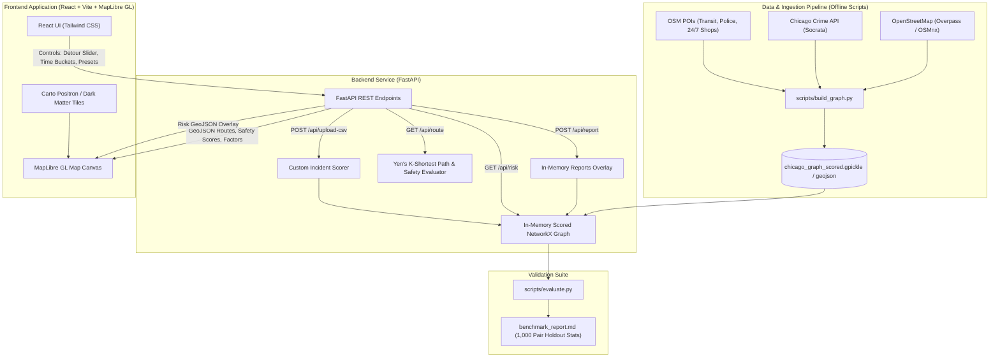

# SafePath (SheShield): Architecture Specification & Execution Plan

Based on the [PRD.md](file:///home/kringe-lord/Projects/HackDay-RNC/SheShield/PRD.md) anchor and the grill-me design alignment, this document freezes the technical architecture, data contracts, and implementation roadmap.

---

## 1. Aligned Technical Decisions

| Dimension | Decision | Rationale |
| :--- | :--- | :--- |
| **Pilot City & Zone** | **Chicago (Downtown / The Loop + River North & West Loop)** | Rich, standardized Socrata Open Crime API with block-level geocoding and hourly timestamps. |
| **Data Storage & Routing** | **Offline Precomputed Graph + In-Memory NetworkX** | Guarantees < 100ms response time for route queries while supporting dynamic in-memory penalties for crowdsourced reports. |
| **Routing Algorithm** | **Constrained Multi-Candidate (Yen's K-Shortest Paths)** | Evaluates top $K$ alternative shortest paths within the user's detour threshold, selecting the candidate with the highest composite safety score. |
| **Crime Weighting** | **Violent / Street-Level Offenses with Footfall Normalization** | Focuses on robbery, assault, battery, and street harassment; normalized against commercial/retail POI density to eliminate busy-area bias. |
| **Street Lighting** | **Hierarchical Fallback Proxy** | Prioritizes OSM `lit` tags; falls back to road functional classification and POI proximity when tags are absent, with confidence scoring. |
| **Unsafe-Spot Reporting** | **Direct Nearest-Edge Penalty** | Submitting a report directly applies a live risk penalty to the single closest street edge in memory. |
| **Frontend Stack** | **React + Vite + Tailwind CSS + MapLibre GL** | WebGL-accelerated vector rendering for smooth colored route polylines and street-level risk overlays. |
| **Basemap Styling** | **Carto Positron (Day) & Dark Matter (Night)** | Clean, high-contrast monochrome basemaps that highlight risk segments and route deltas without visual clutter. |
| **UX & Explainability** | **Comparative Side-by-Side Cards & Worst-Stretch Pin** | Displays +Safety% gain, +Detour overhead, factor breakdown bars, and markers on high-risk segments. |
| **Demo Scenarios** | **Curated 1-Click Presets + Freeform Pinning + CSV Upload** | Fast, deterministic pitching via presets while preserving full interactive map clicks and custom CSV ingestion. |
| **Validation Benchmark** | **Standalone Offline Evaluation Script** | Generates 1,000 random-pair holdout metrics, p-values, and summary charts as Markdown/PDF reports for pitch slides. |
| **Project Structure** | **Monorepo with Docker Compose & Local Dev Runners** | Cleanly separated `backend/` and `frontend/` with root orchestration. |

---

## 2. System Architecture



---

## 3. API Contract Definition

### 1. `GET /api/route`
**Query Parameters:**
- `from_lat`, `from_lng`: Origin coordinates
- `to_lat`, `to_lng`: Destination coordinates
- `time`: `day` | `night` (default: `night`)
- `max_detour`: Float (e.g. `0.20` for 20% max detour over fastest route)

**Response:**
```json
{
  "fastest": {
    "distance_meters": 1420,
    "walking_time_minutes": 18,
    "safety_score": 62,
    "geojson": { "type": "Feature", "geometry": { "type": "LineString", "coordinates": [...] } },
    "worst_segment": { "coordinates": [-87.6298, 41.8781], "reason": "High nighttime incident density" },
    "factors": { "lighting_score": 58, "safe_haven_proximity": 45, "incident_exposure": 70 }
  },
  "safest": {
    "distance_meters": 1610,
    "walking_time_minutes": 20,
    "safety_score": 88,
    "geojson": { "type": "Feature", "geometry": { "type": "LineString", "coordinates": [...] } },
    "worst_segment": null,
    "factors": { "lighting_score": 92, "safe_haven_proximity": 84, "incident_exposure": 22 }
  },
  "delta": {
    "safety_gain_pct": 41.9,
    "detour_overhead_pct": 13.4,
    "extra_minutes": 2
  }
}
```

### 2. `GET /api/risk`
**Query Parameters:**
- `time`: `day` | `night`

**Response:**
- `FeatureCollection` of street segments with normalized risk properties `[0.0 - 1.0]` and color buckets for rendering the street safety overlay.

### 3. `POST /api/report`
**Body:**
```json
{
  "lat": 41.8827,
  "lng": -87.6289,
  "category": "poor_lighting" | "harassment" | "deserted" | "hazard",
  "notes": "Streetlights flickering and dark alley entrance"
}
```
**Response:**
```json
{
  "status": "success",
  "affected_edge_id": 482910,
  "new_edge_risk": 0.85
}
```

### 4. `POST /api/upload-csv`
- Multipart form upload with columns: `latitude, longitude, date_time, category, severity`.

---

## 4. Execution Phases

1. **Phase 1: Project Setup & Monorepo Scaffolding**
   - Initialize `backend/` with FastAPI, OSMnx, NetworkX, GeoPandas, Shapely.
   - Initialize `frontend/` with Vite, React, TypeScript, Tailwind CSS, MapLibre GL.
   - Configure root `docker-compose.yml` and dev startup commands.

2. **Phase 2: Data Pipeline & Graph Scoring (`scripts/build_graph.py`)**
   - Fetch Chicago Downtown/Loop walking graph via OSMnx.
   - Query Chicago Data Portal (Socrata API) for recent violent/street crime records.
   - Extract OSM amenities (police stations, transit stations, 24/7 convenience/shops) and `lit` tags.
   - Compute baseline edge risk weights across `day` and `night` and save pre-scored graph.

3. **Phase 3: Backend Routing Engine & APIs**
   - Implement Yen's K-Shortest Paths candidate generator and safety scoring filter.
   - Implement route factor breakdown and worst-segment identifier.
   - Implement live unsafe-spot reporting endpoint with direct edge penalties.
   - Implement CSV upload endpoint.

4. **Phase 4: Frontend Map Experience & UI**
   - Carto Positron / Dark Matter basemap integration.
   - Dual-route polyline visualizer (fastest vs safest) with worst-stretch pin.
   - Detour slider, time bucket toggle (Day / Evening / Night), and preset buttons.
   - Interactive map clicking for Origin / Destination and Unsafe Spot Reporting modal.
   - Side-by-side comparison cards with delta badges and factor bars.

5. **Phase 5: Validation Benchmark Script & Polish**
   - Implement `scripts/evaluate.py` to run 1,000 random origin-destination pairs on the Chicago graph.
   - Compute safety exposure reduction vs detour overhead and output `evaluation_report.md`.
